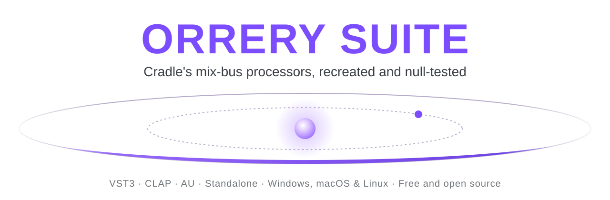
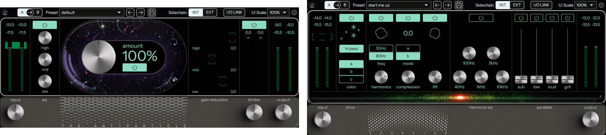
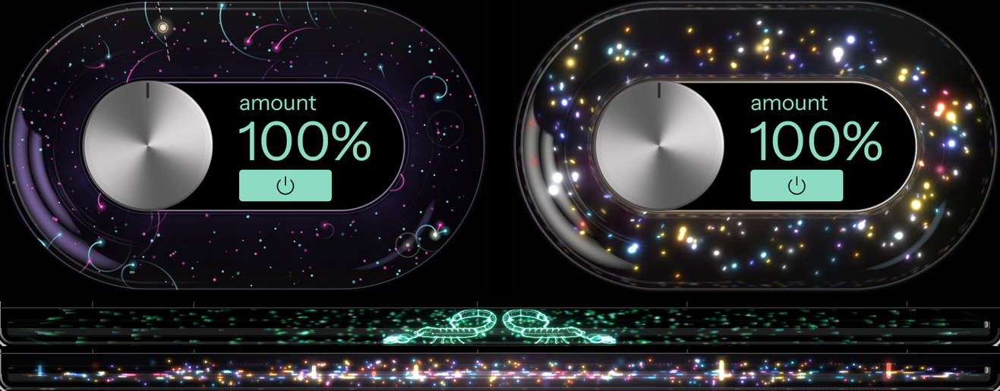

<p align="center">
  <picture>
    <source media="(prefers-color-scheme: dark)" srcset="docs/branding/orrery-banner-dark.svg">
    
  </picture>
</p>

<p align="center">
  <a href="https://github.com/MaymiPR/OrrerySuite/releases/latest"></a>
  <a href="https://github.com/MaymiPR/OrrerySuite/actions/workflows/ci.yml"></a>
  
  
  <a href="LICENSE"></a>
</p>

# Orrery Suite

Free, open-source recreations of Cradle's mix-bus plug-ins, null-tested against the originals. VST3, CLAP and AU for
Windows, macOS and Linux.

<p align="center">
  
</p>

| Plug-in | Recreates | What it does |
|---|---|---|
| **[The Antiparticle](plugins/TheAntiparticle)** | Cradle The God Particle | Mix-bus EQ, multiband "character" saturation and compression, look-ahead limiter |
| **[Scorpius](plugins/Scorpius)** | Cradle Orion | Drum-bus drive, harmonics, compression, lift, harmonic EQ and four parallel paths |

> Orrery Suite is an independent project. It is not affiliated with, endorsed by or sponsored by Cradle or Jaycen
> Joshua. Product names are theirs and only describe what each plug-in is modelled on. No code, models or data of
> theirs is included.

## How it was built

Orrery Suite was created entirely with Claude (Anthropic's AI) and [REA](https://github.com/morluto/rea): the code,
the measurements behind it and this documentation. The originals were the reference throughout, as described in
[The Antiparticle's](plugins/TheAntiparticle/MEASUREMENTS.md) and [Scorpius's](plugins/Scorpius/MEASUREMENTS.md)
measurements.

## Features

- **Null-tested sound.** Each plug-in is measured against its original with the same audio, and every result is
  published, good or bad ([How close](#how-close)).
- **The originals' controls and editors**: same layout, knobs, meters, factory presets and visualisers, measured from
  the originals.
- **A few additions**, in the same top bar on both plug-ins: A / B compare, an external side-chain (INT / EXT) and
  **I/O LINK**, which turns the output down as you turn the input up so you can drive harder at the same level.

  

- **Particle visualisers that follow your music**, in each original's style or ours, moving with the project's tempo.

  

- **Resizable** from 50 to 200 %. Oversampling up to 8x in The Antiparticle.

## Quick start

1. Download the installer for your system from the [latest release](https://github.com/MaymiPR/OrrerySuite/releases/latest).
   One installer holds every plug-in:

   | System | File | Installs |
   |---|---|---|
   | Windows | `OrrerySuite-<version>-Windows-Setup.exe` | VST3 and CLAP to `C:\Program Files\Common Files\`, standalone apps if you choose, with an uninstaller |
   | macOS 10.13+ (universal) | `OrrerySuite-<version>-macOS.pkg` | AU, VST3 and CLAP (you choose which) |
   | Linux x86-64 (glibc 2.35+) | `OrrerySuite-<version>-Linux.tar.gz` | VST3 and CLAP: run `sh install-linux.sh` to copy them to `~/.vst3` and `~/.clap` |

2. Run it, then rescan plug-ins in your DAW.

The installers are not code-signed (that needs paid certificates), so the first launch shows a warning:

- **Windows SmartScreen:** *More info*, then *Run anyway*.
- **macOS 15 and later:** open it once, then System Settings > Privacy & Security > *Open Anyway*. Earlier macOS:
  right-click, then *Open*.

Each release lists SHA-256 checksums in `SHA256SUMS.txt`, so you can check a download.

## Usage

Both plug-ins work the same way:

- **Knobs:** drag up or down. Shift drags finely, Alt-click resets, double-click types a value.
- **Presets:** pick one from the menu or step with the arrows; the disk button saves your own.
- **A / B:** click A or B to switch between two complete settings; the arrow copies the active one over the other.
- **Settings** (gear): particle animation on or off and its style. The Antiparticle also has oversampling and the
  meter mode (RMS or LUFS).

Each plug-in's page covers its controls in detail: [The Antiparticle](plugins/TheAntiparticle#using-it),
[Scorpius](plugins/Scorpius#using-it).

## How close

The residual is the difference between the original's output and ours, in dB below the original's level. Lower is
better: -60 dB is inaudible in practice.

| | The Antiparticle | Scorpius |
|---|---|---|
| Mastered track, default settings | -44.3 dB | -22.4 dB |
| Synthetic music / drums, default settings | -62 to -74 dB | -26.6 dB (drums) |
| Best parts | EQ, crossover, signal path: -79 to -87 dB | EQ, sub, rate converters: -50 to -70 dB |
| Weakest part | the character section's high band on loud, bright material (about -40 dB) | the drive on loud, dense material (the reason for the default's -22 to -27 dB) |

Every case is listed in each plug-in's NULLTESTS.md ([The Antiparticle](plugins/TheAntiparticle/NULLTESTS.md),
[Scorpius](plugins/Scorpius/NULLTESTS.md)), and how the originals were measured in its MEASUREMENTS.md.

## Building from source

```bash
cmake -B build -DAP_TOOLS=OFF
cmake --build build --config Release
ctest --test-dir build -C Release --output-on-failure
```

You need CMake 3.22+ and a C++17 compiler; JUCE is fetched by CMake. Linux packages, installers, the measurement tools
and the repository layout are in [CONTRIBUTING.md](CONTRIBUTING.md).

## Contributing

Found a bug or a difference from the original? Open an
[issue](https://github.com/MaymiPR/OrrerySuite/issues/new/choose) and attach the settings or a preset that shows it.
To change the code, read [CONTRIBUTING.md](CONTRIBUTING.md) for the tests, the null tests against the originals and
the release steps. Changes per version are in [CHANGELOG.md](CHANGELOG.md).

## Security

A file that makes a plug-in crash or misbehave is a security bug. Please report it privately, as described in
[SECURITY.md](SECURITY.md), not in a public issue.

## License

[AGPL-3.0](LICENSE). The interface font, Instrument Sans, is under the
[SIL Open Font License 1.1](shared/resources/fonts/OFL-InstrumentSans.txt).
