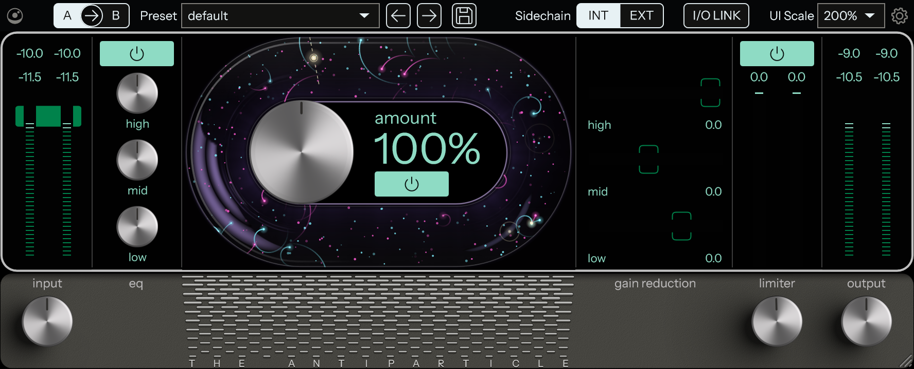
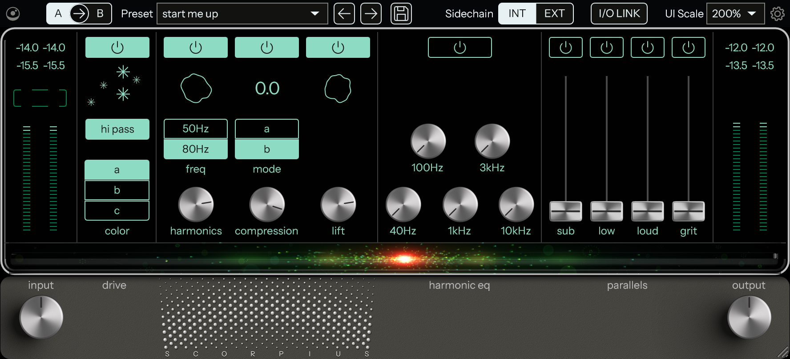

<p align="center">
  <picture>
    <source media="(prefers-color-scheme: dark)" srcset="docs/branding/orrery-banner-dark.svg">
    
  </picture>
</p>

<p align="center">
  <a href="https://github.com/MaymiPR/OrrerySuite/releases/latest"></a>
  
  
  <a href="LICENSE"></a>
</p>

# Orrery Suite

Open-source mix-bus processors (**VST3**, **CLAP**, **AU**) for Windows, macOS and Linux, built with JUCE. Each Orrery
plug-in is an independent, from-scratch recreation of a well-known mixing tool: its controls and look studied, its sound
measured black-box, and the result null-tested against the original, with the numbers published as they are.

An orrery is a clockwork model of the heavens that reproduces their motions. Each Orrery plug-in is a working model
of a well-known original in the same spirit.

> Orrery Suite is an independent project. It is not affiliated with, endorsed by or sponsored by Cradle or Jaycen
> Joshua. Other companies' product names appear only to describe what a Orrery plug-in is modelled on and belong to
> their owners. No code of theirs is included: the sound and the look were measured from the outside.

## Install

Download from the [Releases](https://github.com/MaymiPR/OrrerySuite/releases)
page. One installer per system holds every plug-in in the suite:

- **Windows:** `OrrerySuite-<version>-Windows-Setup.exe` installs the VST3 and
  the CLAP to `C:\Program Files\Common Files\` (in `Orrery Suite` folders) and,
  if you choose, the standalone apps (Start menu), with an uninstaller.
- **macOS** (universal, 10.13 or later): `OrrerySuite-<version>-macOS.pkg`
  installs the AU, the VST3 and the CLAP (you can choose which).
- **Linux** (x86-64, glibc 2.35 or later): `OrrerySuite-<version>-Linux.tar.gz`
  holds the VST3 and the CLAP; run `sh install-linux.sh` to copy them to
  `~/.vst3` and `~/.clap` (see its `INSTALL.txt`).

Then rescan plugins in your DAW.

**Security warnings.** Orrery Suite isn't code-signed or notarized (that needs
paid certificates), so the first time you open it:
- Windows SmartScreen: *More info* → *Run anyway*.
- macOS 15 and later: open it once, then System Settings → Privacy & Security
  → *Open Anyway*. On earlier macOS: right-click → *Open*.

Each release lists the files' SHA-256 checksums in `SHA256SUMS.txt`, so you can
check that a download is the published one.

## Plug-ins

| Orrery plug-in | Modelled on | Status |
|---|---|---|
| **[The Antiparticle](plugins/TheAntiparticle)** | Cradle The God Particle: mix-bus EQ, multiband character and limiter | released: close, not a null on every material (see below) |
| **[Scorpius](plugins/Scorpius)** | Cradle Orion: drum-bus drive, harmonics, compression, lift, harmonic EQ and parallels | released in 1.1.0: close on everything but the drive (see below) |

## The Antiparticle

<p align="center">
  
</p>

The God Particle's chain, rebuilt: input gain, a three-band EQ, the "character" section (a 3-band linear-phase split,
each band a stereo-linked parallel compressor and a sine shaper, amount 0 – 200 %), a look-ahead limiter with a
−0.1 dBFS ceiling, output gain. Oversampling 1 – 8x, an external side-chain for the character section's detectors, the
original's editor, meters and particle visualiser. Two additions of ours: an **I/O LINK** switch (the output follows
the input gain inverted, so driving the chain harder doesn't change the level) and an "antiparticle" particle style.
More: [plugins/TheAntiparticle](plugins/TheAntiparticle).

### Null test (honest numbers)

Residual of The Antiparticle against the original, in dB re the original's output (lower is better; −60 dB is
inaudible in practice):

- **A mastered track** (future house, about −10 dBFS RMS) at the default settings: **−44.3 dB**; the limiter alone
  −60.8 dB, the character section alone −46.1 dB. Character at 125 / 150 / 175 / 200 %: −44.0 / −42.5 / −40.9 / −39.4 dB.
- **Synthetic music** −62 to −74 dB at the defaults; the path, EQ and crossover −79 to −87 dB; amount 0 % −135 dB.
- **Stress suite:** 163 cases over the settings, levels, signals, automation, sample rates and block sizes: **median
  −63.3 dB**, worst −40.4 dB.
- **Weakest:** loud, dense, bright material through the character section's high band (pink noise at −6 dBFS RMS
  −40 dB). Its steady gain curve matches to 0.02 dB; what is left is how fast its detector moves.
- **How:** the crossover filters were identified exactly from the original's impulse responses; the limiter's
  look-ahead planning was identified with probe signals (its inter-sample interpolator fitted per sample rate); the
  character section's laws were fitted against the original on program material and probes. The meters, knobs and
  particles were filmed from the original's editor and matched frame by frame.

Every case: [NULLTESTS.md](plugins/TheAntiparticle/NULLTESTS.md). How it was measured:
[MEASUREMENTS.md](plugins/TheAntiparticle/MEASUREMENTS.md). The editor and controls:
[RESEARCH.md](plugins/TheAntiparticle/RESEARCH.md).

## Scorpius

<p align="center">
  
</p>

Orion's drum-bus chain, rebuilt: input gain, drive (three colours, optional hi-pass), harmonics at 50 or 80 Hz,
compression (two modes), lift, a five-band harmonic EQ, then four parallels mixed in (sub, low, loud, grit) and output
gain. The original's nine factory presets, its A / B compare, editor, meters and particle stripe. Ours on top: an
external side-chain for the compressor, **I/O LINK**, and a "Scorpius" particle style. More:
[plugins/Scorpius](plugins/Scorpius).

### Null test (honest numbers)

- **The fixed parts are close to exact:** the harmonic EQ, the sub and the rate converters (the original's own filters,
  identified from its responses) null at −50 to −70 dB, everything off at 44.1 to 192 kHz at −51 to −110 dB.
- **Everything but the drive** together: −44.6 to −51.0 dB (the default preset with the drive off). Compression
  −41 to −60 dB, harmonics −50 to −71 dB, lift −43.5 to −51.5 dB.
- **The whole default preset:** −26.6 dB on loud drums, −22.4 dB on a mastered track (−34.6 / −31.2 dB 10 to 12 dB
  lower). The limit is the drive: the original runs neural captures there, Scorpius learns its own model
  from the original's input and output, and loud, dense material is where they part.
- **Automation** follows the original's control rate (128-sample chunks, its parameter ramps and switches): an amount
  jump nulls at −60 dB, as well as the setting held still.
- **How:** the original was measured black-box (renders through it offline); the nonlinear modules are small neural
  networks trained on its input and output (on a GPU), the linear parts fitted or identified exactly.

Every case: [NULLTESTS.md](plugins/Scorpius/NULLTESTS.md). How it was measured:
[MEASUREMENTS.md](plugins/Scorpius/MEASUREMENTS.md). The editor and controls:
[RESEARCH.md](plugins/Scorpius/RESEARCH.md).

## Building

CMake 3.22+ and a C++17 compiler. JUCE 8 and clap-juce-extensions are fetched by CMake.

```bash
cmake -B build -DAP_TOOLS=OFF
cmake --build build --config Release
ctest --test-dir build -C Release --output-on-failure
```

That builds every plug-in in every format for the platform (VST3, CLAP and standalone; AU on macOS) and the unit tests.
Without `-DAP_TOOLS=OFF` the measurement tools are built too: hosts for the reference plug-ins (`tools/`) and each
plug-in's fitting helpers. The Windows installer is made with Inno Setup 6:

```bash
pwsh packaging/make_iss_include.ps1 build
iscc /DAppVersion=1.1.0 packaging/OrrerySuite.iss
```

## Repository layout

| Path | What it holds |
|---|---|
| `plugins/<Name>/` | one plug-in: `Source/`, `resources/`, `tests/`, its null-test harness (`nulltest/`, Python, needs the original installed), its fitting tools and its documents |
| `tools/` | hosts for reference plug-ins shared by the suite: offline renders (RefRender), editor films and screenshots (RefCapture), parameter lists (ParamDump) |
| `packaging/` | the installers; `plugins.txt` lists the plug-ins they hold |
| `docs/` | branding and screenshots |
| `.github/workflows/release.yml` | builds, tests and validates every plug-in on all three systems (pluginval at strictness 10, auval on macOS), makes the installers and, on a `v*` tag, publishes a release with the notes from [CHANGELOG.md](CHANGELOG.md) |

Reference renders, measurement data and anything taken from the original plug-ins stay out of the repository (see
`.gitignore`); only the write-ups are published.

## Versions

1.0.0 is the first release, with The Antiparticle; 1.1.0 adds Scorpius. Each new plug-in raises the middle number (the
next one 1.2.0), and fixes and small updates in between raise the last (1.1.1, 1.1.2 ...). Every plug-in carries the
suite's version; [CHANGELOG.md](CHANGELOG.md) lists what changed in each.

## License

[AGPL-3.0](LICENSE). The interface font, Instrument Sans, is under the
[SIL Open Font License 1.1](shared/resources/fonts/OFL-InstrumentSans.txt).
