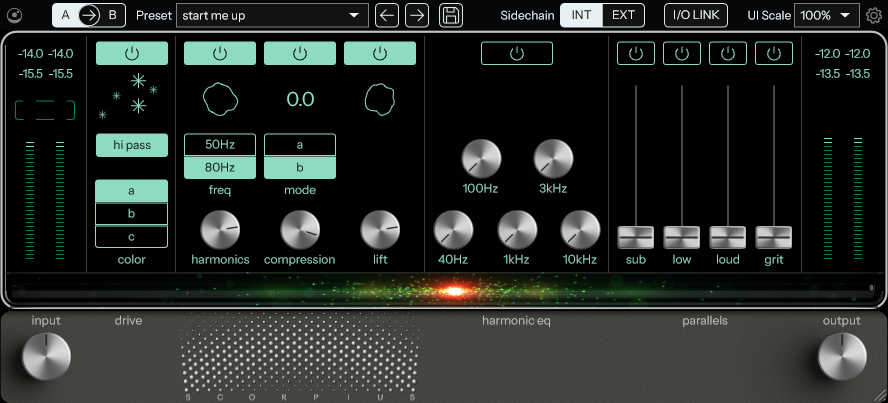
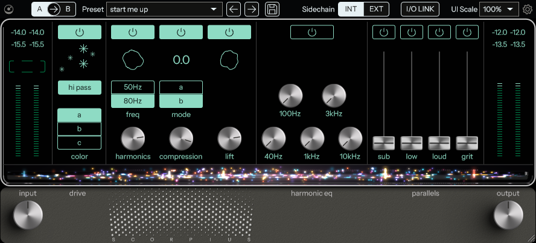

# Scorpius

Part of [Orrery Suite](../../README.md). A recreation of Cradle's Orion (v1.2.1), the drum-bus processor: its controls,
look and sound, null-tested against the original. Named after Orion's mythic opposite, the scorpion.

  
  

- [RESEARCH.md](RESEARCH.md): what the original does, and the UI measurements.
- [MEASUREMENTS.md](MEASUREMENTS.md): how its audio behaves, measured black-box.
- [NULLTESTS.md](NULLTESTS.md): how closely Scorpius matches it, in dB of residual.

## What it does

Input gain feeds the chain below; the four parallels listen to the chain's end and are mixed in; output gain last.
The modules run at 48 kHz, like the original's, with the original's own rate converters at other host rates.

| Stage | What it is |
|---|---|
| Drive | Saturation in three colours (a / b / c) and an optional high-pass after it. |
| Harmonics | Low-end excitement focused at 50 or 80 Hz; the knob is the amount. |
| Compression | A fast, stereo-linked compressor in two modes (a / b); the knob mixes in more or less of it. A readout shows the gain reduction. |
| Lift | Full-range saturation leaning on the highs: presence and transient detail. |
| Harmonic EQ | Five boost-only bands (40 Hz, 100 Hz, 1 kHz, 3 kHz, 10 kHz, 0 … +6 dB), each band's boost softly clipped. Off by default. |
| Parallels | **sub** (more impact low down), **low** (an octave below, for weight), **loud** (perceived loudness without more level), **grit** (accentuated transients), each with its own fader and power button. |

The drive, harmonics, lift and grit are learned models: small neural networks trained on the original's input and
output (none of its code or models is used). The EQ, sub, rate converters and the compressor's gain law are the
original's own filters and curves, identified from its responses.

## Using it

- **Knobs:** drag up / down. Hold Shift for fine adjustment; Alt-click resets; double-click to type a value.
- **Faders** (parallels): drag the cap; the power button above switches the path.
- **Compare A → B** (top bar): two complete settings in one instance; the arrow copies the active one over the other.
- **Sidechain INT / EXT** (ours): EXT has the compressor listen to the side-chain bus instead of the main signal.
- **I/O LINK** (ours): the output gain follows the input gain inverted, so driving the chain harder doesn't change the
  level.
- **Presets:** the nine factory presets of the original ("start me up" is the default); the save button stores your
  own as a `.scorpius` file in `Documents/Scorpius/Presets`.
- **Settings** (gear): particle animation on / off and its style: "Orion" (the original's neon stream) or "Scorpius"
  (ours, the default: venom from a beating heart, played by the music). Both move with the project's tempo.
- **Zoom:** 50 – 200 % from the UI Scale box.

## How close

The fixed parts (EQ, sub, rate converters) null at −50 to −70 dB, everything but the drive at −44 … −51 dB together,
and the whole default preset at about −22 to −27 dB on loud program material (−31 to −35 dB 10 to 12 dB lower): the
drive, a neural capture in the original, is the hard part on loud, dense material. Automation follows the original's
control rate (MEASUREMENTS.md 12). CPU use is a little above the original's (NULLTESTS.md, "CPU").
Every case: [NULLTESTS.md](NULLTESTS.md).

## Tests

- `tests/ScorpiusTests.cpp`: unit tests of the DSP, the processor, the presets, A / B and the side-chain, plus a CPU
  bench (`ctest` after a build).
- `nulltest/`: the null tests against an installed copy of the original (Windows, Python 3.12 or newer with the root
  `requirements.txt`; not in CI). `nullchain.py` (the presets), `nullmod.py` (module by module) and `autom_probe.py`
  (automation) are the entry
  points; `orion.py` is the render harness; the trainers (`train_wn.py`, `train_gain.py`) need PyTorch. The other
  scripts are the measurements and fits that MEASUREMENTS.md cites. Reference renders, captures and measurement data
  stay local (git-ignored).
- `tools/`: ScRender (our processor offline, every DSP constant open to change), the editor snapshot, and the UI
  measurements and fits (fader cap, particle stripe).
