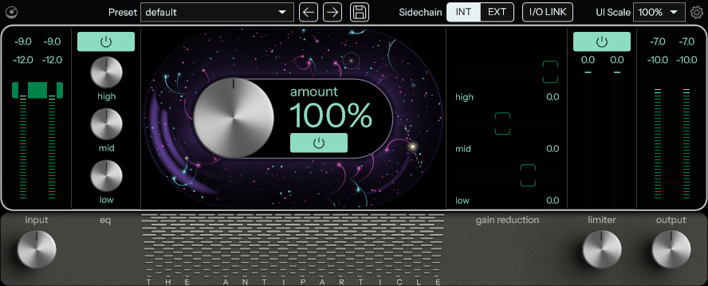
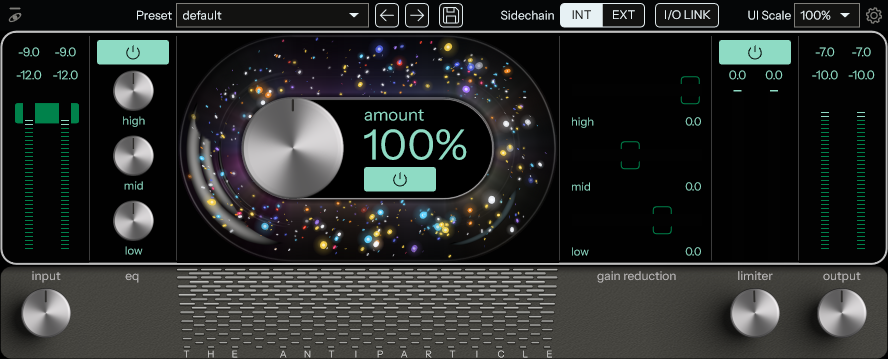

# The Antiparticle

Part of [Newton Suite](../../README.md). A recreation of Cradle's The God Particle (v1.2.4): its controls, look and
sound, null-tested against the original.

  
  

- [RESEARCH.md](RESEARCH.md): what the original does, and the UI measurements.
- [MEASUREMENTS.md](MEASUREMENTS.md): how its audio behaves, measured black-box.
- [NULLTESTS.md](NULLTESTS.md): how closely The Antiparticle matches it, in dB of residual.

## What it does

Input gain feeds the signal chain below, which ends in output gain.

| Stage | What it is |
|---|---|
| EQ | Three RBJ filters: low shelf 180 Hz, bell 637 Hz, high shelf 10 kHz, ±6 dB each. |
| Character, "amount" 0–200 % | A 3-band split by a linear-phase FIR crossover (157 Hz / 2.68 kHz). Each band runs a stereo-linked parallel compressor (it listens to the mid signal) and then a sine shaper (odd harmonics); the side is widened per band. |
| Limiter | Look-ahead with a −0.1 dBFS sample-peak ceiling and a two-speed release; input gain 0 – 12 dB. |

Each stage has its own power button. Oversampling (1 / 2 / 4 / 8x) and the I/O meter mode (RMS or LUFS readouts) are
global settings (gear icon); as in the original, 8x sounds like 4x. INT / EXT picks the character section's detector
input: the main signal or the side-chain bus.

## Using it

- **Knobs:** drag up / down. Hold Shift or Ctrl (Cmd on macOS) for fine adjustment. While the mouse is over a knob, its
  label shows the value.
- **I/O LINK** (top bar, ours): the output gain follows the input gain inverted, so you can drive the chain harder
  without the level changing.
- **Presets:** the arrows step through them; the save button stores the EQ, character and limiter settings as an
  `.antp` file in `Documents/The Antiparticle/Presets`. Input, output and INT / EXT are left as they are.
- **Settings** (gear): oversampling, meter mode, particle animation on / off and its style: "God particle" (the
  original's sparks) or "Antiparticle" (ours, the default: bubble-chamber pair creation and annihilation). The particles follow the
  input level and fade with quiet passages.
- **Zoom:** 50 – 200 % (the box next to the gear). The logo opens the version and About.

## Tests

- `tests/AntiparticleTests.cpp`: unit tests of the DSP and the processor, including filters, the FIR crossover, latency,
  bypass, limiter ceiling, state and extreme input (`ctest` after a build).
- `nulltest/`: the null tests against an installed copy of the original (Windows, Python 3 with numpy and scipy; not in
  CI). `nulltest.py` (the table in NULLTESTS.md), `stress.py` (163 cases) and `track.py` (a music file of your own) are
  the entry points; `tgp.py` is the render harness. The other scripts are the measurements and fits that
  MEASUREMENTS.md cites. Reference renders and measurement data stay local (git-ignored).
- `tools/`: ApRender (our processor offline, every DSP constant open to change), the editor snapshot, the band gain
  computer as a C library for the fits, and the fits of the knobs and the glass.
